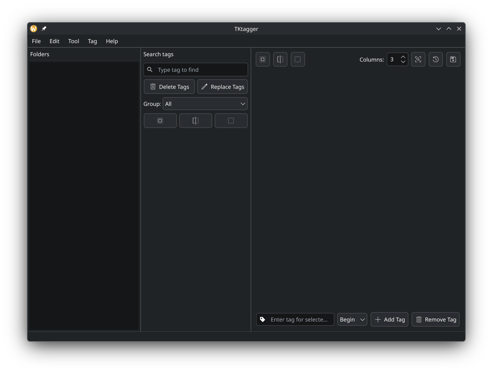

<p align="center">
  
</p>

<h1 align="center">TKtagger Desktop</h1>

<p align="center">
  <a href="README.md">English</a> · <a href="README_VI.md">Tiếng Việt</a>
</p>

TKtagger is a desktop application for preparing and reviewing image captions for AI training datasets. It brings image browsing, manual tag editing, batch cleanup and WD14 automatic tagging into a PySide6 interface for Windows and Linux.

The workspace combines a folder tree, an image grid, a tag panel, image preview and operation history. Review model-generated tags, keep naming consistent with a dictionary, and export dataset repeats as TOML for your trainer. You can adjust the grid, customize keyboard shortcuts and save the dock layout to suit your workflow.



*Interface screenshot; some controls have changed in version 1.5.2.*

## Who this is for

This guide assumes you already understand basic AI training concepts: datasets, captions/tags, LoRA, repeats, batch size and epochs. TKtagger helps prepare the dataset; model selection and training parameters are configured in your training tool. Review automatic tags before using them for training.

## AI-assisted development

This project uses AI coding tools to help write and refactor code, investigate issues and prepare documentation. We disclose that assistance openly. Changes should be reviewed and checked with automated testing; AI-generated code can still contain mistakes. Reproducible bug reports help improve the application.

## Documentation

- [Quick tutorial](tutorial.md): opening a dataset, interface basics, shortcuts, tag editing, batch tools and WD14.
- [Project structure — Tiếng Việt](Project_Structure.md): the main modules and their responsibilities.
- [Automated testing](tests/README.md): regression checks and image-grid benchmarks.

## Main features

- **Image browsing:** folder navigation, a virtual image grid and background thumbnail loading.
- **Flexible cards:** Classic or Auto fit grid, with Moderate, Taller or Full tag content heights.
- **Tag editing:** add or remove comma-separated tags on selected images; insert at the beginning or end in the entered order.
- **Batch tools:** remove duplicates, replace tags, reorder by dictionary groups and switch underscores/spaces.
- **WD14 tagging:** run a local ONNX model or reuse an installed kohya_ss / sd-scripts Python environment and model files.
- **Undo / Redo:** tag-edit history across cached folders, with a history panel and a configurable entry limit.
- **Tag dictionaries:** organize groups and use virtual tag expansion.
- **Dataset Calculator:** calculate repeats and export dataset TOML for kohya_ss / sd-scripts or Musubi Tuner.
- **Custom shortcuts:** primary and alternative bindings for File, Edit and Tool menu commands, with conflict checks.
- **Saved workspace:** save, import/export JSON, reset or enable automatic saving of dock layout and editing preferences.
- **Dataset backup:** folder snapshots before saving changed captions.

## Launch on Windows

Install Python with the `py` launcher, pip and venv available. Open PowerShell in the project folder.

First launch, or when PySide6 is missing:

```powershell
.\launch.cmd --setup
```

This creates `.venv`, installs the GUI requirements and starts the application. Later, double-click `launch.cmd` or run:

```powershell
.\launch.cmd
```

To open a dataset directly:

```powershell
.\launch.cmd "D:\datasets\my_dataset"
```

## Launch on Linux

Make sure `python3`, pip and venv are available. Open a terminal in the project folder.

First launch, or when PySide6 is missing:

```bash
sh ./launch.sh --setup
```

Later launches:

```bash
sh ./launch.sh

# Open a dataset directly
sh ./launch.sh "/path/to/my_dataset"
```

The launchers prefer the project's `.venv`, then `venv`, then the system Python. The basic setup installs the GUI; [the tutorial](tutorial.md#5-wd14-tagger) explains local WD14 dependencies and reuse of an installed tool.

## Supported interface languages

**6 languages:** English (`en`), Vietnamese (`vi`), Simplified Chinese (`zh`), Korean (`ko`), Japanese (`ja`, also accepting the `jp` alias) and Russian (`ru`).

Choose the interface language in **Settings → General**. README translations are available in English and Vietnamese through the links above.

## Automated testing and dataset backup

Run the regression checks with the project Python after GUI setup:

```powershell
# Windows
.\.venv\Scripts\python.exe -m unittest discover -s tests -v
```

```bash
# Linux
./.venv/bin/python -m unittest discover -s tests -v
```

See [Automated testing](tests/README.md) for the full runner and performance checks.

Tag edits and WD14 results stay in memory until **Save**. Before writing changed captions, the application snapshots each affected folder under:

```text
<parent>/.tktagger-backups/<folder>_<hash>/<timestamp>_<id>/
├── data/
└── manifest.json
```

If backup fails, caption saving stops. Snapshots consume disk space and are kept until you remove them. Undo/Redo edits the current session; recovering files already written to disk uses the backup's `data/` folder. See the [tutorial](tutorial.md#8-save-captions-and-dataset-backup) for the save and recovery workflow.

## Roadmap
- [x] Basic tagger UI
- [x] Integrated WD14
- [x] Multi-language support
- [x] System dictionary tags
- [x] Redesigned UI
- [x] Desktop image browsing, tag editing, dictionaries and WD14.
- [x] Adaptive grid, card-height options and customizable shortcuts.
- [x] Dataset TOML export and saved workspace layouts.
- [ ] Refine usability, translations and tutorials from user feedback.

Future items describe maintenance priorities, not a fixed release schedule.

## Latest changelog — 1.5.2

- Added Classic / Auto fit grid modes and three card-height options, including full tag content.
- Added editable menu shortcuts with alternative bindings, conflict detection and default restoration.
- Added workspace save, JSON import/export, automatic saving and reset.
- Changed Dataset Calculator to export trainer-specific TOML with caption validation and unchanged dataset paths.
- Documented local WD14 setup and reuse of an installed kohya_ss / sd-scripts environment.
- Fixed reversed tag order when inserting multiple tags at the beginning.
- Reorganized shared utilities and managers under `libs/`.
- Expanded automated testing for layout, shortcuts, dataset export and tag history; documented dataset backup behavior.
