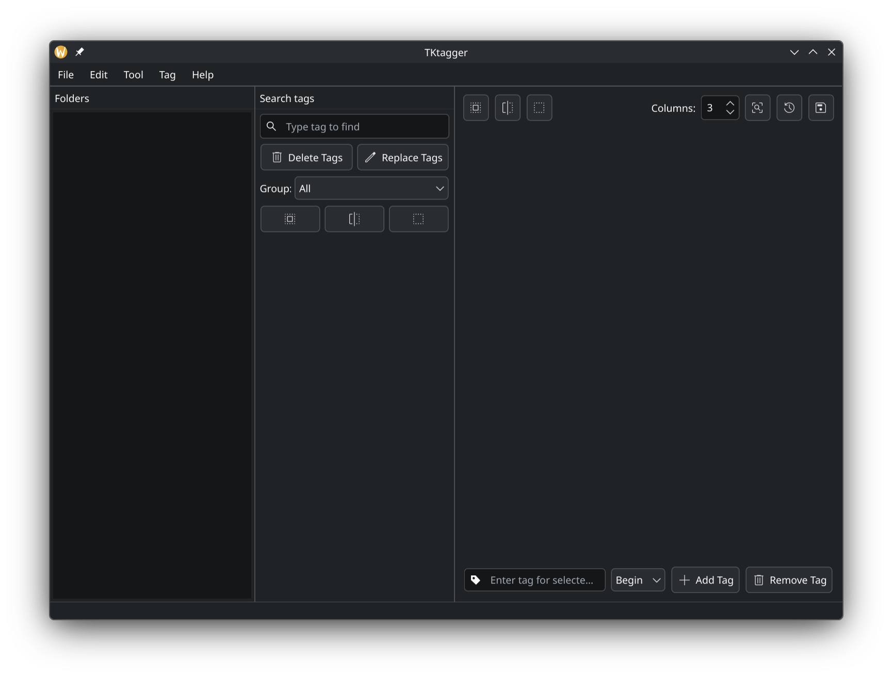

<p align="center">
  
</p>

<h1 align="center">TKtagger Desktop</h1>

<p align="center">
  <a href="README.md">English</a> · <a href="README_VI.md">Tiếng Việt</a>
</p>

TKtagger là ứng dụng desktop để chuẩn bị và kiểm tra caption cho bộ ảnh huấn luyện AI. Ứng dụng kết hợp duyệt ảnh, chỉnh tag thủ công, xử lý hàng loạt và gắn tag tự động bằng WD14 trong giao diện PySide6 dành cho Windows và Linux.

Không gian làm việc gồm cây thư mục, lưới ảnh, bảng tag, khung xem trước và lịch sử thao tác. Bạn có thể kiểm tra tag do model tạo, thống nhất cách đặt tag bằng từ điển, rồi xuất repeat của dataset thành TOML cho trainer. Lưới ảnh, phím tắt và bố cục dock có thể điều chỉnh theo thói quen sử dụng.



*Ảnh minh họa giao diện; một số điều khiển đã thay đổi trong phiên bản 1.5.2.*

## Dành cho ai?

Tài liệu dành cho người đã biết các khái niệm huấn luyện AI cơ bản: dataset, caption/tag, LoRA, repeat, batch size và epochs. TKtagger hỗ trợ chuẩn bị dataset; việc chọn model và thiết lập huấn luyện thực hiện trong trainer. Hãy kiểm tra lại tag tự động trước khi đưa vào huấn luyện.

## Minh bạch về việc sử dụng AI

Dự án có sử dụng công cụ AI để hỗ trợ viết và tổ chức lại mã nguồn, tìm lỗi và soạn tài liệu. Chúng tôi công khai việc sử dụng AI trong quá trình phát triển. Thay đổi cần được rà soát và kiểm tra bằng automated testing; mã do AI hỗ trợ vẫn có thể có lỗi. Báo lỗi kèm các bước tái hiện giúp ứng dụng được cải thiện.

## Tài liệu

- [Hướng dẫn sử dụng nhanh](tutorial_vi.md): mở dataset, làm quen giao diện, phím tắt, chỉnh tag, batch tool và WD14.
- [Cấu trúc dự án](Project_Structure.md): các module chính và vai trò của chúng.
- [Automated testing](tests/README.md): kiểm thử hồi quy và đo hiệu năng lưới ảnh.

## Tính năng chính

- **Duyệt ảnh:** cây thư mục, lưới ảnh ảo hóa và tải thumbnail nền.
- **Thẻ ảnh linh hoạt:** lưới Cổ điển hoặc Tự động điều chỉnh; chiều cao Vừa phải, Dài hơn hoặc Đầy đủ nội dung thẻ.
- **Chỉnh tag:** thêm/xóa nhiều tag phân cách bằng dấu phẩy trên ảnh đã chọn; chèn đầu hoặc cuối theo đúng thứ tự nhập.
- **Batch tool:** xóa tag trùng, thay thế tag, sắp xếp theo nhóm từ điển và chuyển dấu gạch dưới/khoảng trắng.
- **WD14 Tagger:** chạy model ONNX cục bộ hoặc dùng lại Python và model của kohya_ss / sd-scripts đã cài.
- **Undo / Redo:** lịch sử chỉnh tag qua các thư mục đang cache, có bảng lịch sử và giới hạn số bước tùy chỉnh.
- **Từ điển tag:** tổ chức nhóm và hỗ trợ mở rộng tag ảo.
- **Dataset Calculator:** tính repeat và xuất dataset TOML cho kohya_ss / sd-scripts hoặc Musubi Tuner.
- **Phím tắt tùy chỉnh:** phím chính và phím thay thế cho các lệnh Tệp, Chỉnh sửa và Công cụ, có kiểm tra xung đột.
- **Không gian làm việc:** lưu, nhập/xuất JSON, đặt lại và bật tự động lưu bố cục dock cùng tùy chọn thao tác.
- **Dataset backup:** tạo bản sao thư mục trước khi lưu caption thay đổi.

## Mở ứng dụng trên Windows

Cài Python có trình gọi `py`, pip và venv. Mở PowerShell tại thư mục dự án.

Lần đầu chạy, hoặc khi thiếu PySide6:

```powershell
.\launch.cmd --setup
```

Lệnh này tạo `.venv`, cài các thư viện giao diện và mở ứng dụng. Những lần sau, nhấp đúp `launch.cmd` hoặc chạy:

```powershell
.\launch.cmd
```

Mở thẳng một dataset:

```powershell
.\launch.cmd "D:\datasets\my_dataset"
```

## Mở ứng dụng trên Linux

Chuẩn bị `python3`, pip và venv. Mở terminal tại thư mục dự án.

Lần đầu chạy, hoặc khi thiếu PySide6:

```bash
sh ./launch.sh --setup
```

Những lần sau:

```bash
sh ./launch.sh

# Mở thẳng một dataset
sh ./launch.sh "/duong/dan/my_dataset"
```

Launcher ưu tiên `.venv` của dự án, sau đó `venv`, rồi Python hệ thống. Thiết lập cơ bản cài phần giao diện; xem [hướng dẫn WD14](tutorial_vi.md#5-wd14-tagger) để cài thư viện chạy model cục bộ hoặc dùng lại tool đã cài.

## Ngôn ngữ giao diện đã hỗ trợ

**Tổng cộng 6 ngôn ngữ:** tiếng Anh (`en`), tiếng Việt (`vi`), tiếng Trung giản thể (`zh`), tiếng Hàn (`ko`), tiếng Nhật (`ja`, chấp nhận tên `jp`) và tiếng Nga (`ru`).

Chọn tại **Cài đặt → Chung → Ngôn ngữ**. README có bản tiếng Anh và tiếng Việt qua liên kết ở đầu trang.

## Automated testing và dataset backup

Chạy kiểm thử hồi quy bằng Python của dự án sau bước thiết lập giao diện:

```powershell
# Windows
.\.venv\Scripts\python.exe -m unittest discover -s tests -v
```

```bash
# Linux
./.venv/bin/python -m unittest discover -s tests -v
```

Xem [Automated testing](tests/README.md) để chạy bộ kiểm thử đầy đủ và đo hiệu năng.

Các chỉnh sửa tag và kết quả WD14 nằm trong bộ nhớ cho tới khi bấm **Lưu**. Trước khi ghi caption thay đổi, ứng dụng sao lưu từng thư mục bị ảnh hưởng vào:

```text
<thư_mục_cha>/.tktagger-backups/<tên_thư_mục>_<hash>/<timestamp>_<id>/
├── data/
└── manifest.json
```

Nếu backup lỗi, việc lưu caption dừng lại. Các bản sao chiếm dung lượng và được giữ cho đến khi bạn xóa. Undo/Redo chỉnh sửa trong phiên làm việc; để khôi phục file đã ghi, dùng thư mục `data/` của bản backup. Xem [hướng dẫn lưu và khôi phục](tutorial_vi.md#8-lưu-caption-và-dataset-backup).

## Roadmap

- [x] Giao diện desktop, chỉnh tag, từ điển và WD14.
- [x] Lưới tự điều chỉnh, tùy chọn chiều cao thẻ và phím tắt tùy chỉnh.
- [x] Xuất dataset TOML và lưu bố cục làm việc.
- [ ] Cải thiện độ phản hồi với dataset lớn dựa trên kết quả đo thực tế.
- [ ] Mở rộng kiểm thử hồi quy và kiểm tra cấu hình trainer.
- [ ] Hoàn thiện thao tác, bản dịch và tài liệu từ phản hồi người dùng.

Các mục tiếp theo thể hiện ưu tiên bảo trì, chưa phải lịch phát hành cố định.

## Changelog mới nhất — 1.5.2

- Thêm hai chế độ lưới Cổ điển / Tự động điều chỉnh và ba mức chiều cao thẻ, gồm hiển thị đầy đủ nội dung tag.
- Thêm tùy chỉnh phím tắt menu, phím thay thế, phát hiện xung đột và khôi phục mặc định.
- Thêm lưu không gian làm việc, nhập/xuất JSON, tự động lưu và đặt lại.
- Chuyển Calculator sang xuất TOML theo trainer, kiểm tra caption và giữ nguyên đường dẫn dataset.
- Bổ sung hướng dẫn thiết lập WD14 Local và dùng lại môi trường kohya_ss / sd-scripts đã cài.
- Sửa lỗi đảo thứ tự khi chèn nhiều tag vào đầu danh sách.
- Gom tiện ích và module quản lý vào `libs/`.
- Mở rộng automated testing cho bố cục, phím tắt, xuất dataset và lịch sử tag; bổ sung tài liệu dataset backup.
